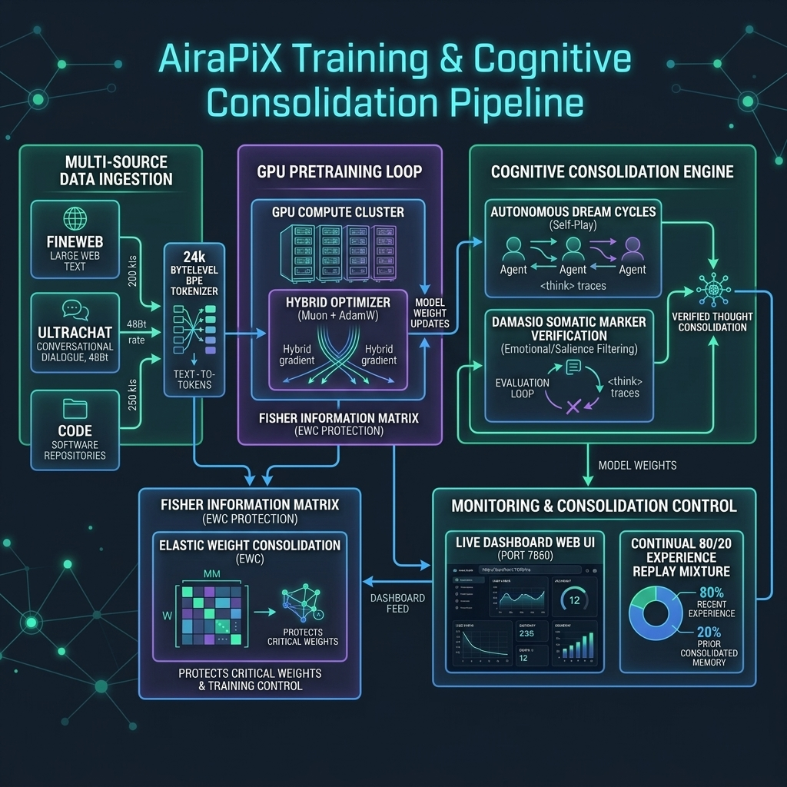

# Aira AI Model Training & Cognitive Architecture Report

## Dual-System Hybrid Reasoning, Neuromodulation, Hebbian Plasticity & Continual Learning

  

---

### 1. Executive Summary & Overview

This report provides an in-depth technical explanation of the newly implemented Aira Cognitive Agent Architecture, its Multi-Task Training Loop (`train_v2.py`), the Live Web UI Monitoring Dashboard (`live_dashboard.py`), and the Continual Learning Subsystems (`dream_engine.py` and `continual.py`).

Aira incorporates an advanced Dual-System architecture combining:
1. **System 1 (Intuitive Reflex & Neuromodulation)**: Sub-50ms non-autoregressive Theory of Mind emotional perception, Kenji Doya 4-chemical neuromodulation, Damasio Somatic Markers gut check, and online Hebbian synaptic adaptation.
2. **System 2 (Deliberate Autoregressive Reasoning)**: 24,000-vocabulary Transformer with native `<think>` and `</think>` inner monologue delimiters, executing multi-step chain-of-thought problem deconstruction before generating conversational replies.

---

### 2. Core Architectural Subsystems

#### 1. 24,000 Tokenizer with Native Deliberation Delimiters
- Expanded ByteLevel BPE vocabulary from 12k to 24,000 tokens, halving token fragmentation on technical code and mathematics.
- Dedicated native tokens `<think>` (ID: 4) and `</think>` (ID: 5) separate inner deliberation from outer dialogue.

#### 2. Doya 4-Chemical Neuromodulation & Damasio Somatic Markers
- Implements biologically grounded neurochemical state tracking:
  - **Dopamine**: Reward anticipation, curiosity, and creative exploration.
  - **Serotonin**: Emotional stability, patience, and homeostatic calm.
  - **Noradrenaline**: Vigilance, alertness, and anomaly detection.
  - **Acetylcholine**: Learning rate, attention focusing, and novelty salience.
  - **Oxytocin & Cortisol**: Relational bonding and acute stress response.
- **Damasio Somatic Markers**: Evaluate proposed actions and generate visceral risk scores, preventing catastrophic, destructive, or hallucinated executions.

#### 3. Experiential Hebbian Neuroplasticity
- Online associative weight matrix (`AffectiveSynapseEngine`) that updates dynamically during dialogue without GPU backpropagation:
  $$\Delta W_{token, emotion} = \eta \cdot \text{co\_activation} \cdot \text{reward}$$
- Serialized to disk (`Aira_Synaptic_Memory.json`) to persist learned human behavioral traits across reboots.

#### 4. Dual-Track Epistemic Trust System
- **User Track**: Initialized at 50% baseline trust, expanding to 100% as mutual milestones succeed.
- **Peer AI Model Track**: Initialized at 20% trust, strictly hard-capped at 60% with mandatory verification checks to guard against hallucinated external data and prompt injection attacks.

#### 5. Persistent Obsidian Memory Vault Engine
- High-performance in-memory BM25 inverted index supporting sub-millisecond retrieval.
- Somatic dopamine valence weighting (reward-verified notes ranked higher).
- Automatically writes conversation transcripts with YAML frontmatter to `C:\Users\WaveWalker\Aira-Vault\Conversations\` and appends session summaries with `[[wikilinks]]` to today's Daily Note (`01 - Daily Notes/`).

#### 6. Continual Lifelong Learning Subsystems
- **Strategy 5 (Autonomous Dream Cycles)**: Offline self-play engine (`AiraDreamEngine`) that queries vault notes for unresolved questions, generates step-by-step `<think>` reasoning traces, validates them with somatic markers, and queues verified instances into training shards.
- **Strategy 7 (Anti-Catastrophic Forgetting via EWC & 80/20 Replay)**:
  - **80/20 Experience Replay Mixture**: 80% foundational pretraining tokens blended with 20% fresh experience tokens.
  - **Elastic Weight Consolidation (EWC)**: Employs the empirical Fisher Information matrix diagonal ($F_i$) to apply quadratic regularization against parameter drift in critical pretraining weights:
    $$\mathcal{L}_{EWC} = \mathcal{L}_{task} + \frac{\lambda}{2} \sum_i F_i (\theta_i - \theta_i^*)^2$$

#### 7. Interleaved Hybrid MLA + SSM Transformer Backbone
- **MLA (Multi-Head Latent Attention)**: Compresses Key-Value projections into low-rank latent vectors every 4th layer, cutting KV cache footprint by ~93%.
- **Diagonal SSM Mixer**: Linear-complexity state-space recurrence on intermediate layers for efficient long-context processing.
- **Muon + AdamW Hybrid Optimizer**: Muon for 2D matrix parameters and AdamW for 1D vectors and normalization layers.

---

### 3. Interactive CLI & Real-Time Monitoring

- **Cognitive Agent CLI (`python -m airapix.agent.chat`)**: Live ASCII banner displaying dopamine, serotonin, noradrenaline, oxytocin, cortisol, user trust, peer AI trust, stamina, curiosity, and detected emotional intent.
- **Live Web Dashboard (`live_dashboard.py`)**: Glassmorphic dashboard on port 7860 tracking real-time loss, perplexity, throughput (tok/s), and GPU VRAM utilization.

---

### 4. Roadmap & Milestone Progression

- **Phase 1 (Complete)**: Hybrid MLA + SSM architecture, dataset pipeline, and 24k tokenizer training.
- **Phase 2 (Active)**: Base multi-task pretraining running on GPU (`train_v2.py`) with continuous milestone checkpoints.
- **Phase 3 (Next)**: Autonomous tool sandbox execution with Damasio somatic safety gating before bash/python execution.
- **Phase 4**: Full lifelong recursive consolidation combining background LoRA micro-adapters with offline dream self-play.

---
*Report generated in `Report/` directory.*
